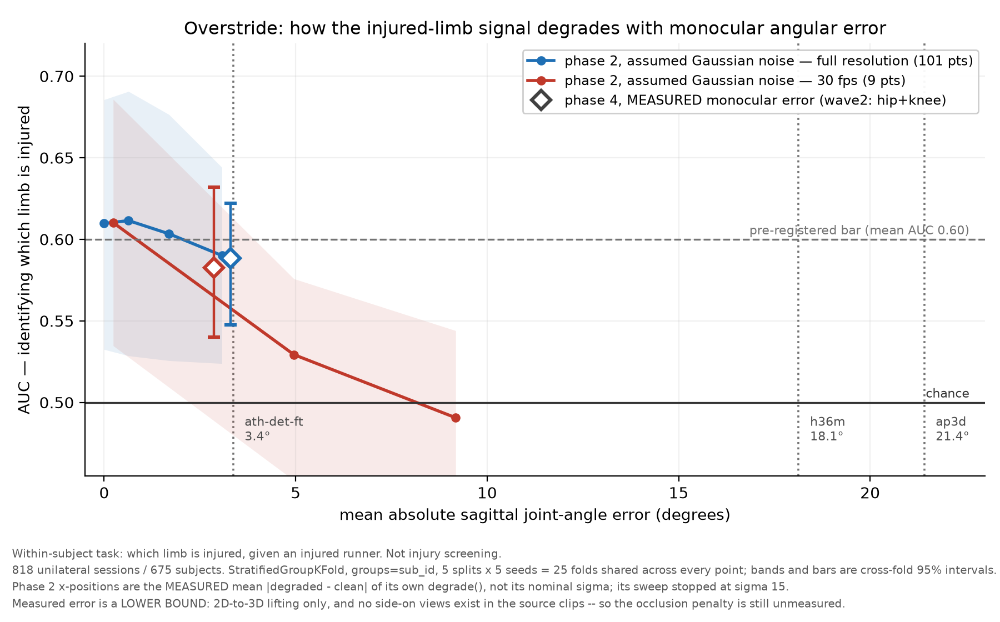
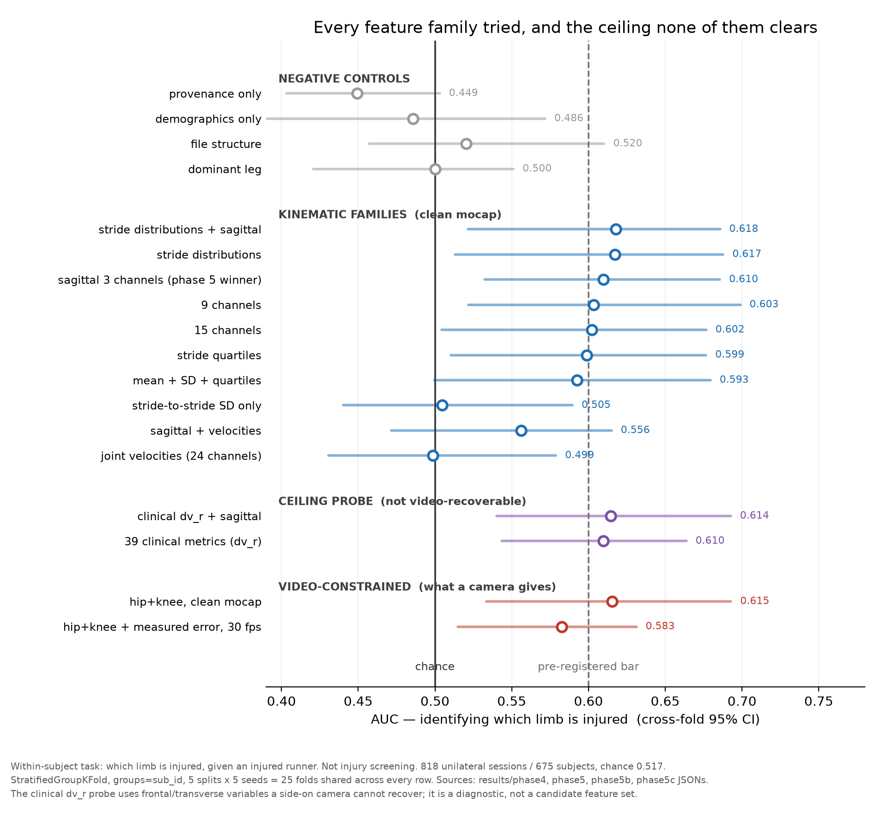
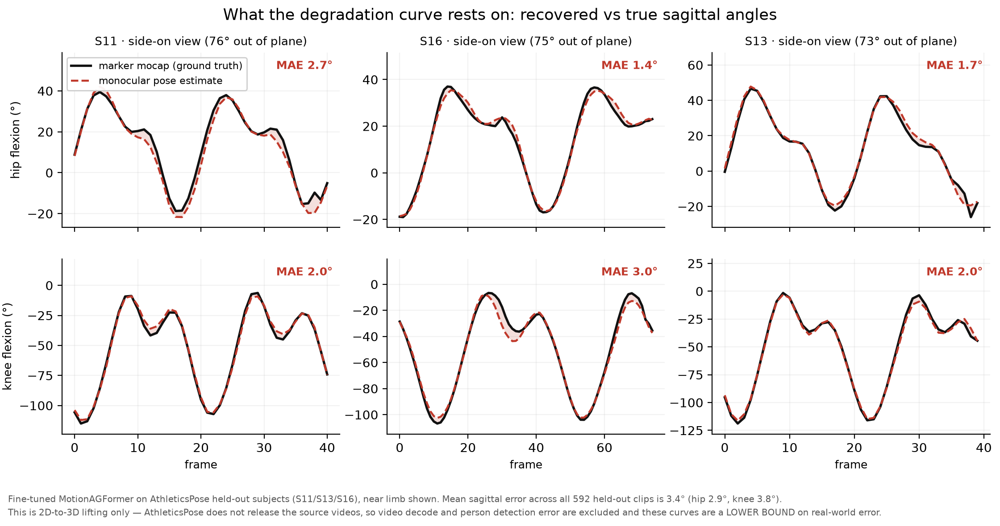
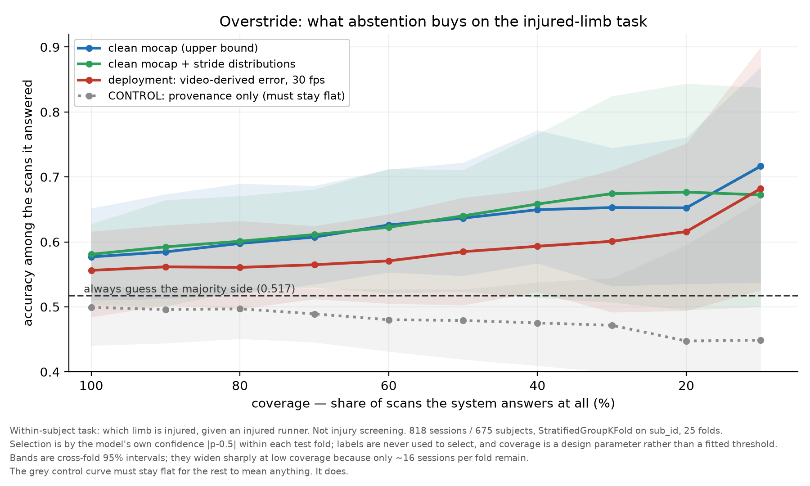

# Overstride

**Injury screening for runners from monocular video — a measurement, and a
negative result.**

The project asked one question: *how much injury-classification performance is
lost when lower-limb kinematics are recovered from a single camera instead of a
motion capture lab?*

**The answer is about 0.03 AUC. The reason it is so small is that there was very
little to lose.**

---

## The finding

Going from marker-based motion capture to monocular video costs **0.027–0.033
AUC** on the only task in this dataset that carries any kinematic injury signal
at all. But that task — identifying *which limb* is injured in a runner already
known to be injured — tops out at **AUC 0.610** on perfect mocap, and lands at
**0.583** once real measured video error is injected. Chance is 0.517.

**The camera is not the bottleneck. The physiology is.** Six phases of
diagnostics say the ceiling is a property of what unilateral running injury does
to stance-phase gait symmetry in this cohort, not of how it has been modelled.

Two later phases sharpened that sentence. A **positive control** (phase 8) showed
the design resolves a consistent asymmetry of **0.25°**, so the ceiling is not an
underpowered test — the observed 0.610 is worth about **0.17° RMS**. And the word
*running* in it is now measured rather than assumed: the same task on the same
archive's **walking** trials, restricted to subjects who did both, reaches only
**0.547 [0.465, 0.627]** with all five negative controls at chance (phase 9).



## Two levels, two verdicts

**Screening — does this runner have an injury? Failed outright.**
Zero of 60 pre-registered tests survived Benjamini–Hochberg correction. No
kinematic feature set beat a decontaminated demographics control in any of five
injury conditions. Worse, a **provenance-only** model — questionnaire
missingness and collection year, no physiology whatsoever — scores **0.775
pooled and 0.863 on patellofemoral pain**, because questionnaire completeness
tracks the study wave and the waves differ in injury mix. Most of what looks like
a gait signal in this dataset is paperwork.

**Within-subject limb identification — which side is injured? Real, but small.**
Comparing a runner's injured limb to their own healthy limb in the same trial
eliminates the confound by construction: demographics, provenance, file structure
and limb dominance are all constant within a session, and all four were verified
at chance (max |AUC − 0.5| = 0.051). That task clears its pre-registered bar at
**0.610 [0.532, 0.686]** — and then fails every deployment requirement.

## Why the ceiling is the signal, not the model



Five independent lines of evidence, each designed to detect headroom:

| test | result |
|---|---|
| **Different measurement modality** — 39 clinical frontal/transverse metrics (pronation, hip adduction, pelvic drop, step width) | **0.610**, identical to the sagittal waveform model. ΔAUC +0.000 [−0.067, +0.071] |
| **Severity dose-response** (pre-registered, direction declared before fitting) | ρ = **+0.044** [−0.038, +0.130], p = 0.228. Flat, and anti-monotone by stratum |
| **Learning curve** | 0.585 → 0.599 → 0.608 → 0.610. The last quarter of the data bought **+0.001** |
| **Four more feature families** — velocities, stride distributions, per-condition splits | Best is +0.008 with a CI spanning [−0.110, +0.089]. Velocities score **0.499** |
| **Abstention and repeat scans** | Neither rescues the deployment configuration |
| **Positive control** — inject a known asymmetry and sweep its magnitude | Design resolves **0.25°** at AUC 0.681. Not underpowered; the 0.610 is worth ≈**0.17° RMS** |
| **A second gait mode** — the same task on walking, paired dual-mode subjects | **0.547** [0.465, 0.627], fails the bar. The ceiling is not a property of gait in general |

If the ceiling were an artefact of the sagittal waveform representation, a
clinical scalar set built from different planes and different physics would not
reproduce it to three decimals.

## What the video pipeline actually costs

Sport-fine-tuned monocular pose recovers sagittal joint angles to **3.4° mean
absolute error** (MPJPE 51.7 mm), against a published band of 14.1–25.8° for
generic models on clinical gait — the generic checkpoint here reproduces that
band at 18.1°, which is what validates the setup.

> **Which 3.4°?** That figure is the configuration phase 3 ran: AthleticsPose's
> *fine-tuned* 2D detections, which a real video cannot produce. Phase 7 measured
> all six configurations on the same 592 clips. The tool as it ships — generic
> COCO detections, edge padding, overlapped windows — is **3.51°**, and that is
> the baseline phases 13–16 are measured against. Fine-tuned detections with the
> same two fixes reach 3.18°, which is *not* deployable for the same reason. The
> whole spread is 0.33°, so nothing here turns on the choice; stating which one
> is quoted does, because a later gate could otherwise be passed by swapping
> detectors instead of improving the method.



> ## And on a lab it has never seen, it is 8.1–9.7° — about 2.3–2.8× worse
>
> *The range spans two tests on the same dataset: 9.61–9.73° on two subjects that
> had been inspected repeatedly, and **8.08° on five sealed subjects that had
> never been opened** — the figure to read as the claim. Both are below.*
>
> **Phase 15 ran the frozen pipeline on BML MoVi, held out until that phase, and
> this is a loss reported as prominently as the win above.** Side-on
> machine-vision video, jogging: **9.61° near / 10.60° far**, against the
> 3.51° / 3.62° the tool scores on AthleticsPose — about **2.7× worse**.
>
> **n = 2.** A third subject was **excluded**, because it failed a check that was
> pre-registered before the data was downloaded — 42% of its frames lose the
> very markers the measurement's reference frame is built from. That exclusion is
> prescribed by the frozen protocol, is enforced in code, and moved the figure by
> 0.12°. The pre-exclusion figure (n=3) was 9.73° / 10.56° and is kept in
> the record. **At two subjects a bootstrap interval is just the range of the two
> means and carries no information beyond them** — do not read the CIs in that
> report as uncertainty about a population.
>
> That baseline is **a different dataset, camera, population and movement**, so
> the ratio is not attributable to any one of them. Feeding the same lifter a
> perfect 2D — the reference 3D projected through the same camera — gives
> **6.51°**, so roughly a third of the error is the 2D detector and two thirds
> is already there without it. **That split does not generalise:** the detector's
> share is 4.35° on one subject and 1.85° on the other. The hip error is a
> one-signed offset on both, but −7.2° against −3.3°, so it is **not**
> a single fixed convention offset either.
>
> Two things this does **not** show. **It is still not a test on phone footage:**
> MoVi's hand-held iPhone clips ship no calibration and their synchronisation
> cannot be verified from the dataset's own flags, so they are reported as traces
> with no error figure, and §7.5 stays open. And the **viewpoint curve below
> did not replicate** on the one frontal clip measured. See
> `results/phase15.md`.
>
> **These two subjects were later superseded as the headline test.** They had
> been inspected repeatedly by the time this figure was produced. The **sealed
> test below** ran the same frozen pipeline once on **five subjects that had
> never been opened** and scored **8.08° combined near** — so read 9.61° as what
> the spent subjects gave, and the sealed figure as the claim.

> ### Hip and knee are not one measurement, and they disagree about which lab is hard
>
> The combined figure stays as the pre-registered headline. Split by joint,
> each against its own AthleticsPose baseline:
>
> | joint | MoVi PG1 (n=2) | AthleticsPose | ratio |
> |---|---|---|---|
> | **knee**, near | **8.16°** | **4.07°** | **2.00×** |
> | **hip**, near | **11.06°** | **2.83°** | **3.90×** |
>
> **The ordering inverts.** On AthleticsPose the knee is the worse joint; on
> MoVi the hip is. A combined mean cannot show that.
>
> **The reason is definitional, not optical.** Hip flexion is measured against
> the pelvis→thorax axis, and phase 15C found that **the lifter does not put
> its own thorax on the same anatomical point in the two datasets** — `CLAV`
> to within **0.75°** on AthleticsPose, but **87–144 mm** from CLAV on MoVi,
> nearer Visual3D's `THORAX` on 7 of 7 subjects. That is 8–16° of trunk
> direction, 2–4× the whole AthleticsPose hip error.
>
> **The knee is immune to this by construction** — it is a difference of two
> angles inside one frame, so rotating the frame cannot change it, and 24 of 24
> rows in phase 15C were bit-identical across thorax definitions.
>
> So: **the knee number measures the camera path; the hip number measures the
> camera path plus a convention the model does not hold fixed.** See
> `results/phase15c.md`.

> ### The sealed test: five subjects never opened, and they are not worse
>
> Every MoVi number above comes from subjects that were **spent** — measured,
> inspected, and in two cases used to diagnose defects in the pipeline itself.
> **Phase 15's sealed test is the one run on people the method had never seen.**
> Five subjects, the pipeline pinned by **content hash** in a pre-registration
> that was committed alone and **pushed before a single sealed byte was
> downloaded**, run once. **All five passed every pre-registered check, so
> nothing was excluded.** `results/phase15_sealed.md`.
>
> | quantity | limb | sealed (n=5) | 95% CI | spent subjects (n=4) |
> |---|---|---|---|---|
> | **knee flexion** | near | **8.41°** | [6.28, 10.98] | 9.27° |
> | **knee flexion** | far | **8.69°** | [6.55, 10.68] | 9.73° |
> | **thigh inclination** (gravity) | near | **5.40°** | [4.14, 6.84] | 6.28° |
> | **thigh inclination** (gravity) | far | **7.37°** | [5.46, 9.26] | 6.49° |
> | hip (trunk-referenced) | near | **7.75°** | [6.30, 8.93] | 12.27° |
> | combined hip+knee | near | **8.08°** | [6.42, 9.67] | 10.77° |
>
> **Three of the four primary figures are lower than on the spent subjects**, and
> every CI contains the figure it is compared against. These are different
> people, so no paired test exists — the honest reading is **indistinguishable,
> not better.** What it rules out is the thing it was built to catch: that the
> MoVi loss was an artifact of four over-inspected subjects.
>
> **The quantity that failed the tune-set gate is the one that transfers.** Phase
> 15D's G1 rejected gravity-referenced thigh inclination at 6.69° against a
> 4.12° bar on AthleticsPose. On held-out MoVi it scores **5.40° near — better
> than on the tune set**, while the knee degrades 2.07× and the hip 2.73×.
> Gravity is a reference the model does not have to infer; the pelvis→thorax
> axis is one it re-invents per dataset. **A gate set on the tune set was
> confidently wrong about which measurement was good, and only held-out data
> could show that.**
>
> **The error is a per-subject offset, not noise.** Across five subjects MAE
> tracks `|bias|` at **r = 0.983** (knee), while the waveform shape is tracked
> well on everyone — knee r **+0.77 to +0.92**. One subject is nearly unbiased
> (+0.56°, 5.13° MAE); another carries +12.1°. The camera cannot explain it: the
> level-camera error is −1.4° to −1.9° on all five.
>
> **The hip's error is a posture term, not a convention offset.** Phase 15
> saw −7.2° against −3.3° on two subjects; five more extend it to a smooth
> **−2.92° to −8.23°** spread. The hip is also the one quantity whose intervals
> **do not overlap** the spent subjects' — 7.75° against 12.27°. **The quantity
> phase 15C called least transferable improved most on people it had never
> seen**, because four subjects were not enough to see its spread.
>
> **A far-limb penalty, resolved for the first time in this project** — and only
> for quantities referenced to an external axis. Paired per subject, CI
> excluding zero, same sign on all five: **thigh +1.97° [+0.98, +3.19]** and
> **hip +1.51° [+0.61, +2.53]**. The knee shows none (+0.28°, CI spans zero),
> which is what its structure implies: it is a difference of two angles inside
> one frame, so an occluded-limb depth error largely cancels. The
> never-pool-near-and-far rule is the only reason this was visible.
>
> **And perfect 2D is still not an upper bound.** Feeding the lifter the
> reference 3D projected through the camera's own calibration is **worse on the
> trunk for all five subjects** (−2.5° to −4.6°) and worse on the near hip for
> four of five. The knee's detector share spans **11.4° and changes sign**
> (−2.46° to +8.92°). The thigh is the sole exception — positive on all five,
> **the only quantity here for which "a better detector would help" is
> measured rather than assumed.**

Two findings make the camera path *better* than expected:

- **The far-limb occlusion penalty is ~0** for the *joint* angles, and does not
  grow with viewing angle. **Qualified by the sealed test above:** that holds for
  the knee (+0.28°, CI spans zero), but quantities referenced to an *external*
  axis do carry a resolved penalty — thigh +1.97°, hip +1.51°, both CIs
  excluding zero on five held-out subjects.
  Originally +0.07° *extrapolated*; **phase 11 measured it** on an independent
  lab's four calibrated cameras, where sagittal error falls **3.50° → 1.77°**
  monotonically as the view becomes side-on. It shrinks rather than grows.
- **Accuracy improves as the view becomes side-on** — 4.66° → 2.11° across
  view-angle quartiles on AthleticsPose, and **3.50° → 1.77° on AthletePose3D**,
  a different lab with different athletes and cameras. An effect that survives
  that change of dataset is a property of monocular lifting, not of one rig — and
  side-on is exactly the geometry this application prescribes.

## Why no demo was built

A per-user readout would misrepresent the evidence. At the realistic operating
point (hip+knee, side-on camera error, 30 fps, pooled out-of-fold AUC 0.569):

| | value |
|---|---|
| best PPV | **0.574** against a 0.517 base rate |
| sensitivity at 90% specificity | **0.130** |
| calibration slope | **0.716** (1.0 is perfect) |
| Brier improvement over a constant | **1.5%** |
| **agreement on repeat scans of the same runner** | **0.667** |

**The model changes its mind about the same runner on a third of repeat scans** —
0.744 even on perfect mocap. And averaging a runner's repeat sessions does *not*
help (0.587 → 0.583), which means the error is **subject-specific rather than
random**: the model is consistently wrong about the same people. That closes the
"just scan them twice" escape route.

Selective classification — answering only the most confident scans — does work
on mocap (**0.637 [0.548, 0.722]** at 50% coverage, validated against a control
curve that stays flat). On video-derived data no coverage level reliably beats
guessing.



## Phases and gates

| # | work | gate | outcome |
|---|---|---|---|
| 0 | Inventory, join, verify against Table 1 | inventory exists, Table 1 reproduces | Met |
| 1 | Injury classifier vs demographics control | beat the control | Not met — **kill criterion fired**, 0/60 tests |
| 2 | Degrade to video constraints | degradation measured | Met — interaction found; σ labels later corrected |
| 3 | Video → 3D kinematics | MAE within published range | Met — 3.4° fine-tuned, 18.1° generic |
| 3B | Viewpoint geometry | — | Met — overturned a unit error; occlusion penalty ~0 |
| 4 | Measured error through the phase-2 model | real ΔAUC | Met — −0.027 to −0.033 |
| 4B | Operating point, calibration, repeatability | — | Not met — not deployable |
| 5 | Within-subject limb identification | beat the population model | Met — 0.610, all confounds at chance |
| 5B/5C/5D | Ceiling diagnostics, feature attempts, abstention | — | Not met — ceiling is the signal |
| 6 | Methods demo + synthesis | — | this document |
| 7 | Harden the inference path; video → kinematics tool | — | Met — −0.25° recovered; 3.4° confirmed at 3.43° |
| 8 | Positive control: inject a known asymmetry, sweep it | method detects a known effect | Met — resolves 0.25°; 0.610 ≈ 0.17° RMS |
| 9 | A1 — the same limb task on walking, paired subjects | clears phase 5's bar | Not met — 0.547, does not replicate |
| 10 | C — a second lab's markers (Fukuchi) through the MATLAB pipeline | sane kinematics outside the archive | Met — speed 1.71%; hip \|r\| 0.993 |
| 11 | B1 — AthletePose3D through the lifting path | lifter transfers; viewpoint measured | Mixed — lifter degrades 1.84×; viewpoint 3.50°→1.77° |

**Phase 1's kill criterion fired and the project continued deliberately**, onto
the within-subject task, which met an equivalent pre-registered bar against a
stronger control set. That pivot is recorded in `results/phase02.md`.

**Technical report — [Making a Null Trustworthy](https://claude.ai/code/artifact/3f66cc72-bf12-49d2-852b-19ed58e9a404)** ([source](docs/technical-report.html)).
Written for someone outside this project: how the null was made worth believing,
what the provenance confound was, and the corrections ledger. Start here if you
want the method rather than the repository.

Reviewing this work? See [`docs/REVIEW.md`](docs/REVIEW.md) — current state,
every published claim that moved and why, where the work is weakest, and the
decisions outstanding.

Resuming this work? Start with
[`docs/AGENT_CONTEXT.md`](docs/AGENT_CONTEXT.md) — current state, the traps that
already cost real errors, and an honest register of what is still missing.

Full reports: [`results/`](results/) — one `phaseNN.md` per phase, each with
cross-fold CIs, the exact split, n per group, and what was excluded and why.
A single-page synthesis with all four figures is at
[`docs/overstride.html`](docs/overstride.html), built by
`scripts/phase6_page.py`.

## Reproduction

```bash
uv sync
cp .env.example .env          # set DATA_ROOT to the Ferber archive

.venv/Scripts/python.exe scripts/phase0_inventory.py
.venv/Scripts/python.exe scripts/phase5_limb.py           # the limb task
.venv/Scripts/python.exe scripts/phase3_infer.py          # ~90 min CPU
.venv/Scripts/python.exe scripts/phase4_real_delta.py     # the degradation curve
.venv/Scripts/python.exe scripts/phase6_numbers.py        # every number above, from source
```

### Running it on your own video

```bash
.venv/Scripts/python.exe scripts/video_kinematics.py --video CLIP.mp4 --out DIR
.venv/Scripts/python.exe -m pytest tests/ -q
```

Side-on clip of a single runner in, hip and knee flexion traces out. **It is a
kinematics extractor and says nothing about injury** — phases 4B and 5D
established a per-runner verdict is unsupportable. It prints its full error
budget on every run and refuses to write output when it cannot find the subject.
See `results/phase07.md`.

Waveforms are **derived, not stored** — the archive holds raw marker
trajectories and scalar summaries only, and the 101-point stance curves come from
the bundled MATLAB pipeline. See `CLAUDE.md` for the full conventions.

## What a reader should not conclude

- **Not that running gait carries no injury information.** This is one cohort,
  one protocol, treadmill running, stance phase only, with a provenance confound
  that had to be removed by construction.
- **Not that monocular pose estimation is inadequate.** It is not the limiting
  factor here — it costs ~0.03 AUC, and its errors are a *lower bound* (2D→3D
  lifting only; the source videos are not released, so decode and detection error
  are excluded).
- **Not that a different model would fix it.** That is the specific claim phases
  5B–5D were built to test, and it does not hold.
- **Nothing here forecasts future injury.** Every label describes injury status
  at the time of testing. This is detection and classification only.

## Data and licensing

- **Ferber / Running Injury Clinic Kinematic Dataset** (n=1,798) — never
  committed; lives at `$DATA_ROOT`, covered by `.gitignore`.
- **AthleticsPose** (CC BY-NC-SA 4.0) and **AthletePose3D** (non-commercial
  research only) — used for the monocular error measurement. **Commercial use is
  prohibited**, and no commercial framing of this work is permitted.
